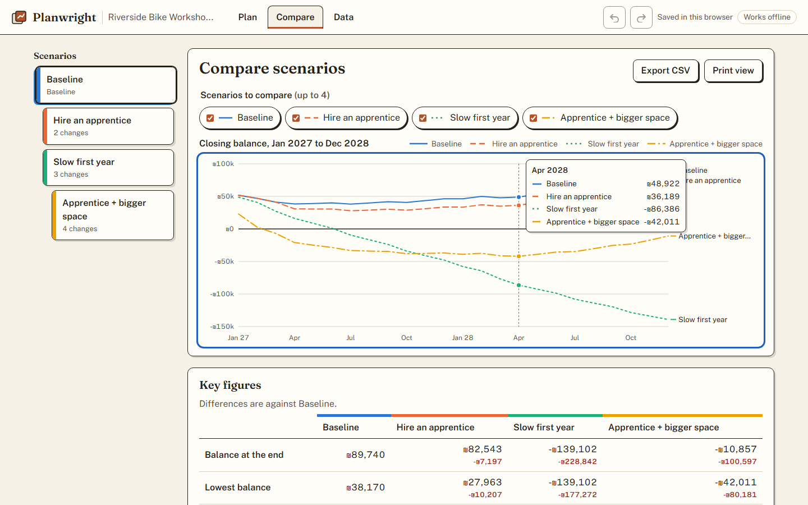
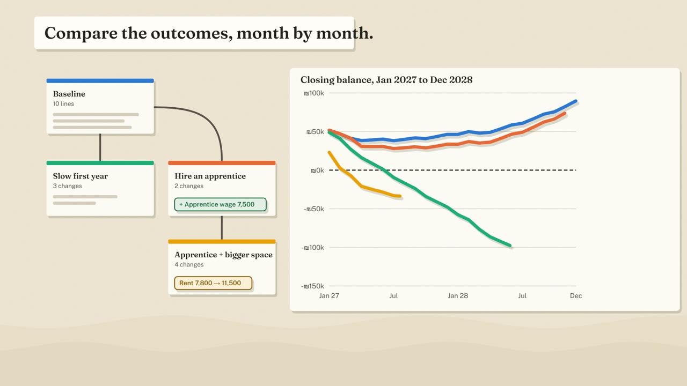
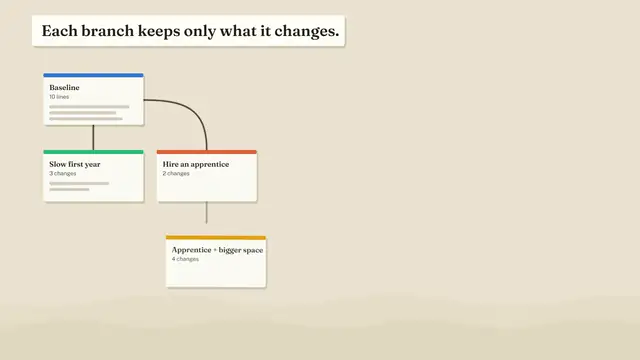
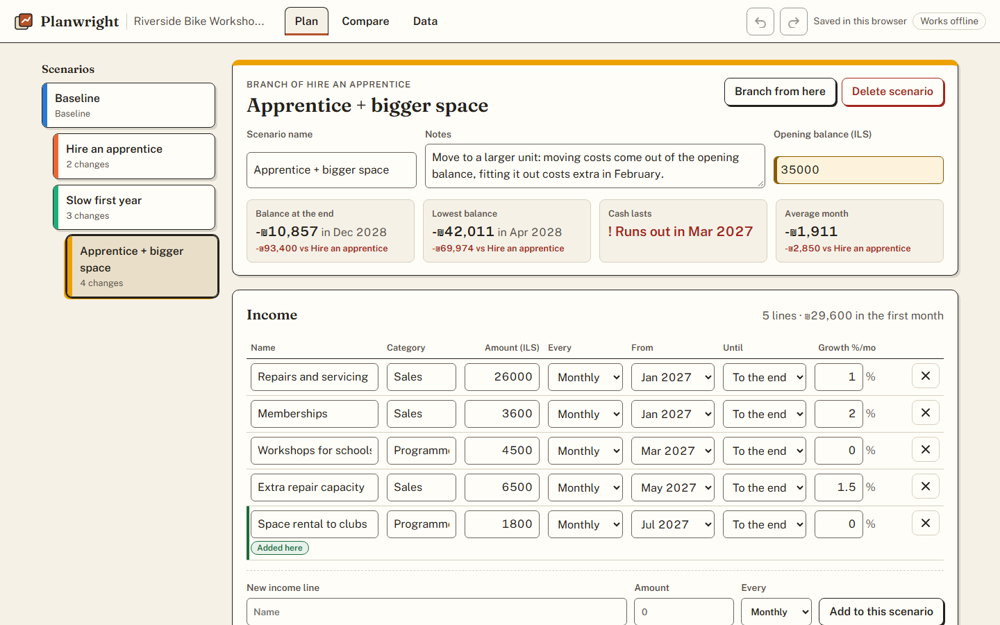
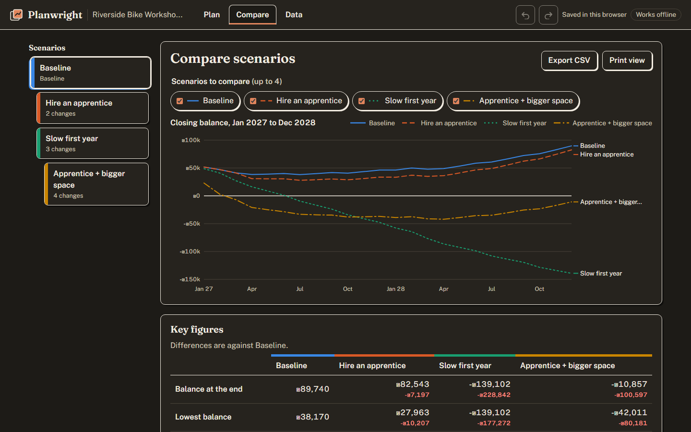
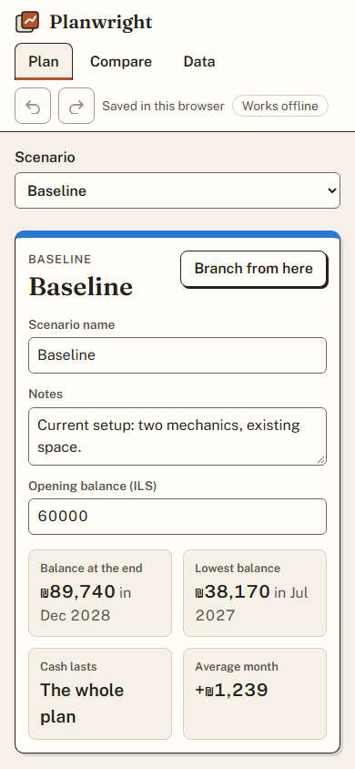

# Planwright

Plan a budget month by month, branch it into what-if scenarios and compare them side by side. Each branch
stores only what it changes, so editing the baseline updates every scenario built on it. Everything runs in
the browser: it works offline, saves locally, exports and imports versioned files, and prints a clean report.



**Specialisation shown:** Frontend engineering: state design (branching overrides, undo/redo), UX for
editing numbers, accessibility, offline support and performance budgets, in a static site with no backend.

## Product film

[](https://github.com/gad-rapaport/planwright/releases/download/v0.1.0/planwright-film.mp4)

21 seconds, no sound needed: a workshop owner weighs two decisions, branches the plan, sees each branch keep
only its changes, compares the balances (real numbers exported from the app) and decides with the printed
report. [Download or play the MP4](https://github.com/gad-rapaport/planwright/releases/download/v0.1.0/planwright-film.mp4)
(release asset; needs access to this repository while it is private). Made from code in
[animation/](animation/): [brief](docs/ANIMATION-BRIEF.md), [storyboard](docs/ANIMATION-STORYBOARD.md),
[rendering](docs/ANIMATION-RENDERING.md).



## What it does

- **Branching scenarios.** Start from a baseline, branch "Hire an apprentice", branch again from that. A
  branch records only its changes (set a field, add a line, remove a line, different opening balance).
  Changed fields are marked; any change can be reverted, removed lines restored.
- **Lines** with an amount, cadence (monthly, quarterly, yearly, once), first and last month and monthly
  growth.
- **Compare** up to four scenarios: balance chart (keyboard readable, direct labels and dash patterns, not
  colour alone), key figures with differences, the month the cash runs out, a monthly table.
- **Undo and redo** for every change (Ctrl+Z, Ctrl+Shift+Z or Ctrl+Y), including deletes and imports;
  typing in one field counts as one step.
- **Your data stays yours.** Autosave in the browser, JSON export and import with a format version, a preview
  before replacing, migration of older files and clear errors for bad ones. CSV export neutralises text that a
  spreadsheet would run as a formula.
- **Offline** after the first visit (service worker), with an explicit "New version: reload" prompt.
- **Print view** that becomes a report on paper or PDF.

| Branch editor                               | Dark theme                                 | Phone                                 |
| ------------------------------------------- | ------------------------------------------ | ------------------------------------- |
|  |  |  |

## Stack

TypeScript, React 19, React Router 7, Vite 8, Zod 4 for the file format. No UI or chart library: the
chart, fields and layout are hand-written. Fraunces and Public Sans bundled with the app. Vitest, Playwright
with axe-core. Served by unprivileged nginx with a strict Content Security Policy. Docker Compose, GitHub
Actions.

## Quick start

```powershell
./scripts/ops.ps1 setup      # build the image and start it
```

Open **http://127.0.0.1:8104**. The sample plan (a fictional community bike workshop) loads on the first
visit. No accounts, nothing to configure.

```powershell
./scripts/ops.ps1 start | stop | status | logs | test | e2e
npm ci; npm run dev          # development server on http://127.0.0.1:5184 (no service worker)
```

## Tests

| Suite                                                                                         | Count | Command            |
| --------------------------------------------------------------------------------------------- | ----- | ------------------ |
| Unit (engine, scenarios, history, file format and migration, CSV, persistence, store, budget) | 65    | `npm test`         |
| E2E against the image (desktop and phone, axe-core, offline, print, headers)                  | 15    | `npm run test:e2e` |
| Bundle size budget                                                                            | 4     | `npm run budget`   |

Measured on the local image: 117 KB of compressed JavaScript before the editor renders; first paint 1.8 s on
a throttled mid-range phone profile on first visit and 0.4 s on later visits with nothing downloaded.
[docs/TESTING.md](docs/TESTING.md) has the details and gaps.

## Documentation

[Architecture](docs/ARCHITECTURE.md) · [Decisions](docs/DECISIONS.md) · [File format](docs/FILE-FORMAT.md) ·
[Setup](docs/SETUP.md) · [Security](docs/SECURITY.md) · [Testing](docs/TESTING.md) ·
[Operations](docs/OPERATIONS.md) · [Deployment](docs/DEPLOYMENT.md) · [Design](docs/DESIGN.md) ·
[Demo script](docs/DEMO.md) · [Exercises](docs/EXERCISES.md) · [Slim profile](docs/SLIM.md) ·
[Storage](docs/STORAGE.md) · [Changelog](CHANGELOG.md)

## Limitations

- One plan per browser. Several plans means exporting and importing files.
- No sharing or collaboration: there is no server by design.
- Amounts are whole currency units; one currency per plan; no inflation or tax model.
- Plans in `localStorage` can be cleared by the browser; the app says so and points to export.

The sample business and its figures are invented. No licence has been chosen for this code yet; font
licences are listed in [docs/DESIGN.md](docs/DESIGN.md#assets-and-licences).
